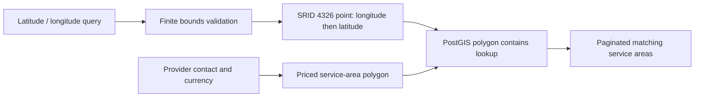

# Provider service-area API

A GeoDjango/REST Framework exercise for registering transport providers, storing priced polygon service areas, and finding areas that contain a requested latitude/longitude. The original Mozio exercise context and [upstream repository attribution](https://github.com/dev-nezuko/transfer-service-router) are retained. It performs spatial coverage lookup, not journey routing or fare optimization.

## Request flow



| Route under `/testapp/` | Behavior |
| --- | --- |
| `provider/` and `provider/{id}/` | Provider CRUD |
| `service_area/` and `service_area/{id}/` | Service-area CRUD |
| `search_service_area/?lat=5&lng=5` | Areas containing the point, ten per page |

Use trailing slashes. For the synthetic square from `(0,0)` to `(10,10)`, latitude `5`, longitude `5` lies inside. A query response has DRF's `count`, `next`, `previous` and `results` fields. Actual IDs/counts depend on your local data. The `contains` lookup excludes a point exactly on the boundary; changing to boundary-inclusive coverage is a product decision, not an equivalent query.

## Local setup requires PostGIS

The source targets Django 3.2, DRF 3.13 and native GIS bindings from the committed legacy requirements. Use an isolated environment compatible with those pins; the full historical environment has not been reproduced here. You need PostgreSQL with the PostGIS extension and compatible GEOS/GDAL libraries. SQLite is not a substitute for this integration test path.

```sh
python3 -m venv .venv
source .venv/bin/activate
python -m pip install -r requirements.txt
```

Create a disposable local PostGIS-enabled database using your normal database tooling. Configure these **shell environment variables** (the app does not automatically read `.env`):

- `POSTGRES_DB`, `POSTGRES_USER`, `POSTGRES_PASSWORD`, `POSTGRES_HOST`, `POSTGRES_PORT`
- A private `DJANGO_SECRET_KEY`
- `DJANGO_DEBUG=true` only for a local demo; `DJANGO_ALLOWED_HOSTS` defaults to loopback/localhost

[.env.example](.env.example) lists the names but contains no usable secret. If no signing key is set, debug mode creates a process-local random key; non-debug startup requires a private key.

```sh
python manage.py migrate
python manage.py runserver 127.0.0.1:8000
```

The DRF browsable API exposes fields for creating providers and service areas. A provider requires name, email, phone, language and currency. A service area requires a provider ID, name and price; polygon geometry is nullable in the existing model. Areas without polygons are excluded from coverage searches. Provider deletion cascades to its service areas.

## Checks and current boundaries

```sh
# Pure numeric validation, no Django/GIS/native library required:
python -m unittest testapp.test_coordinates -v

# Requires the configured PostGIS/native GIS environment:
python manage.py test testapp
```

Three pure test groups pass for normal/boundary coordinates, missing values, and nonfinite/out-of-range values. All Python files parse. The existing provider/service-area/search integration tests were reviewed but could not run because this verification environment lacks GEOS/GDAL and a PostGIS database. Polygon persistence, spatial indexes, API serialization and full migrations therefore remain unverified.

CRUD routes currently have no explicit API authentication or ownership policy. Keep this as a loopback-only exercise with synthetic contact data; configure access control before hosting. Other useful work includes polygon validity/price validation, API schema examples verified against PostGIS, and boundary/overlap tests. No UI, geocoding service, external maps, payment integration or performance benchmark is implemented.
